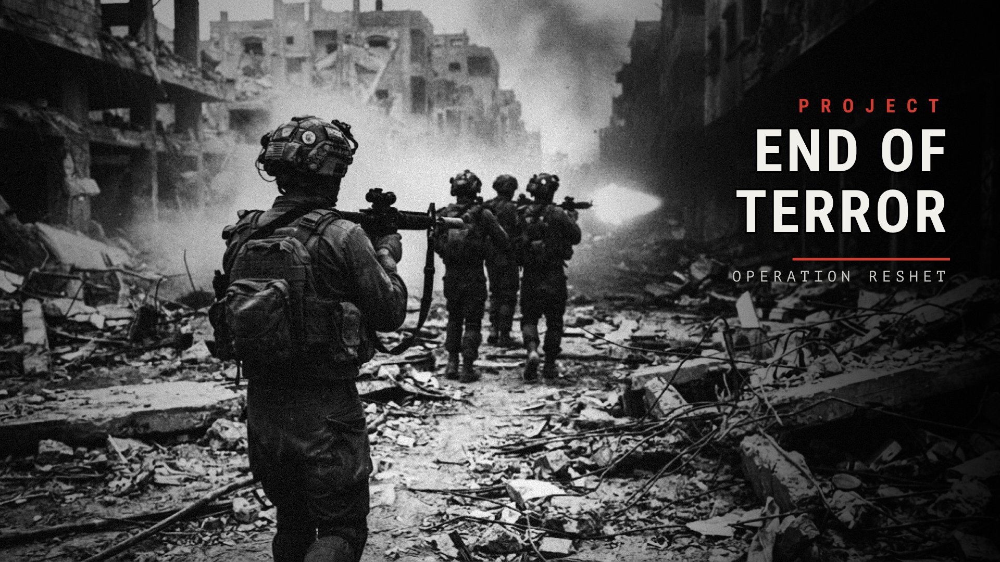

# Project: End of Terror



Первая операция — «Решет» (מבצע «רשת»).

При запуске — заставка «Project: End of Terror» (чёрно-белое изображение, сгенерировано автором проекта в нейросети; встроено в игру, копии — в `art/`).

Тактическая игра для смартфона в духе Radio Commander. Ночь, вымышленный город Дейр-Набиль. Вы — командный пункт роты спецназа и управляете группами только по рации: поля боя не видно, метки на карте ставите сами по докладам.

Задача — к рассвету (05:30) задержать или ликвидировать командира террористической ячейки по кличке «Инженер» и уничтожить мастерскую взрывных устройств, не причинив вреда мирным жителям. Город, группировка и персонажи вымышленные.

## Версии

Одна игра на трёх языках: русском, английском и иврите. Язык переключается на заставке и в штабе (кнопки RU · EN · עב), выбор запоминается на устройстве. Сохранения и кампания у каждого языка свои.

- `ru/` — открывается на русском,
- `en/` — на английском,
- `he/` — на иврите (справа налево).

Можно открыть с нужным языком и по ссылке: `?lang=ru`, `?lang=en`, `?lang=he`.

## Что есть в игре

- Силы: две штурмовые группы ЯМАМ с глушителями и ПНВ, элитная группа мистаарвим («Вишня» / «דובדבן»), сапёры «Яхалом» («Алмаз» / «יהלום»: тихо снимают ловушки, подрывают мастерскую и подземный ход), собаки «Окец», операторы малых дронов в каждой группе.
- Беспилотник наблюдения, ударный вертолёт (перезарядка на базе или смена; режим прикрытия района: тепловизор и пушка, но громко — тревога сразу), вертолёты эвакуации.
- Мастерская опасна: без сапёров подрыв дольше и рискованнее, бой внутри может вызвать вторичный взрыв, удар по ней задевает соседние дома.
- Тихий вход и захват спящих, подрыв стены, снайпер против наблюдателей, засада на патруль.
- Процедура «скороварка» (נוהל סיר לחץ), «стук по крыше» (הקש בגג), правило подтверждения цели и список запрета на удары.
- Поведение противника по открытым источникам о действиях ячеек ХАМАС и группировок Западного берега: малые группы «обстрелял — сменил позицию», отход в жилые дома и в поликлинику, мобилизация местных вооружённых через громкоговорители, СВУ на улицах против машин, дом-ловушка с динамиком, бегство с оружием, брошенным в жилом доме.
- Командиры групп действуют сами по наставлениям («реакция на контакт», бой в городе, TCCC): под огнём группа отвечает огнём и уходит в укрытие вне видимости стрелка, докладывает направление и дальность, затем по обстановке держит укрытие и подавляет, при перевесе обходит с фланга и штурмует, при слабости разрывает контакт и обходит простреливаемые улицы; раненым под огнём — только жгуты. Бой только при прямой видимости вдоль улиц.
- Шум вместо мгновенной тревоги: выстрелы противника и взрывы поднимают ячейку, «Инженер» бежит к подземному ходу.
- Раненые мирные жители: помощь санинструктора, скорая через координационное управление, эвакуация вертолётом.
- Задержанного «Инженера» можно быстро опросить на месте (может соврать или промолчать) или вывезти вертолётом в ШАБАК (дольше, но показания надёжнее) — так можно узнать, где мастерская.
- Разбор после операции: реальное положение всех сил и путь «Инженера».
- Экстренная эвакуация любой группы на базу (раненые — медикам, задержанный — ШАБАК, пополнение БК); вертолёт эвакуации летит прямо к группе.
- Подсказки, где мастерская: район из разведки на карте, разведка здания и собаки, допрос задержанного, обыск тела «Инженера».
- Автосохранение на устройстве: при следующем открытии можно продолжить операцию с того же момента или начать заново.
- Группы ходят по улицам, а не сквозь дома. Темп «скрытно» (~2,5 км/ч) или «быстро» (~6 км/ч, но группу легче заметить и услышать).
- «Вишня» ездит на гражданской машине (~25 км/ч) и высаживается в выбранной точке, машина ждёт там.
- Зачистка дома занимает от 2 до 15 минут в зависимости от площади и этажности.
- Время: начало 02:00, рассвет 05:30. После рассвета растёт «мировой резонанс» (видео в соцсетях, иностранные СМИ), он же растёт от разрушений и пострадавших мирных и снижает итог. В 06:30 — отход в любом случае. Когда задачи выполнены, штаб даёт отход сам.

## Кампания

- Рота «Кобра» идёт из операции в операцию. Перед каждой операцией открывается экран штаба: состав групп, итоги прошлой операции, память о погибших, журнал операций.
- Бойцы поимённо: имя, звание, должность (командир, медик, оператор дрона, пулемётчик, подрывник, сапёр, снайпер), число операций. ЯМАМ — звания пограничной полиции, «Яхалом» и «Дувдеван» — звания ЦАХАЛ. Опыт даёт повышение в звании.
- Погибшие не возвращаются. Раненые пропускают от одной до трёх операций. Недостающих заменяет пополнение; вернувшиеся раненые идут в резерв, на операцию берут самых опытных.
- В эфире потери передают только номерами, имя появляется отдельной строкой в журнале командира. Если выбыл медик, раненым хуже; если выбыл оператор дрона, у группы нет дрона; если выбыл командир, командование принимает самый опытный.
- Опыт бойцов делает группу точнее и устойчивее. Группа растёт в уровне (до 5) и получает навык по специализации: ЯМАМ — быстрая зачистка, взятие живыми, огневая дисциплина, скрытное выдвижение; «Яхалом» — быстрое разминирование, направленный заряд, подрыв мастерской; «Дувдеван» — легенда прикрытия, разведка, снайперская пара.
- Начать операцию заново нельзя: потери окончательные. «Новая кампания» на экране штаба стирает роту и историю.

## Тренировка

Отдельный режим без прокачки (вкладка «Тренировка» на экране штаба). Кампанию не затрагивает.

- **Код операции** (4 цифры) задаёт город и противника: один код — одна и та же карта и расстановка. Можно переиграть или передать код другому.
- **Сложность** (4 уровня) — бюджет противника: охрана цели, резервные группы, наблюдатели, патрули, СВУ, ловушки, сколько местных поднимут по тревоге.
- **Застройка**: редкая, обычная, плотная.
- **Местность генерируется заново для каждого кода**: тип застройки (город с прямыми улицами, старый город с узкими переулками, лагерь беженцев, деревня с дворами, город со старым центром), форма, размер и место города, главные улицы и диагональная трасса, подъездные дороги, грунтовки, холмы с отметками высот, вади, оливковые рощи и сады, поля, кладбище, мечеть, школа, поликлиника. Превью карты — прямо на экране тренировки. В садах и в русле вади за городом группу замечают реже. Карта кампании не меняется.
- **Разведсводка** — оценка, а не правда: диапазон численности, наблюдатели, ловушки. Реальный расклад — в разборе.
- **Рекомендация штаба**: соотношение сил (ориентир 3:1 и больше для штурма), список задач, которые закрыты или нет, кнопка «Взять рекомендованный состав». Переключатель **«Лимит штаба»** не даёт взять больше рекомендованного числа групп.
- **Полный список подразделений** (до 7 групп, каждого типа до двух):
  - спецназ и полиция: ЯМАМ, «Дувдеван», «Маглан», «Эгоз»;
  - разведка пехотных бригад: «Сайерет Голани», разведбат «Цанханим», «Сайерет Гивати», разведбат «Нахаль»;
  - пехотные бригады: «Голани», «Цанханим», «Гивати», «Нахаль», «Кфир» (взвод, 16 бойцов, без глушителей);
  - инженерные войска: «Яхалом»;
  - Корпус охраны границ: «Каракаль», «Бардалас», «Львы Иордана» — только справка, в рейдах они не участвуют.
- У каждого подразделения два описания: «Из открытых источников» (со ссылкой) и «В игре». **Сведения о подразделениях — только из открытых источников (Википедия, сайт ЦАХАЛ, СМИ). Численность и характеристики в игре — игровые условности.**
- Особые умения: «Маглан» — управляемые ракеты по огневой точке и дальняя оптика; «Нахаль» и его разведбат — опрос жителей; «Кфир» — блокпост, на котором задерживают вооружённых, идущих по тревоге; «Эгоз» — засады на патрули.

## Приказы и доклады

- **Занять здание** (приказ отряду) — группа входит без зачистки и занимает первый этаж (в одноэтажном доме — первую комнату от входа). Держит позицию, ведёт огонь и наблюдение из окон, стены защищают от огня с улицы. Дом не проверен, это риск: ловушка на двери срабатывает при входе, ловушка внутри может сработать позже, а спящие на верхних этажах проснутся через 1–5 минут и начнут бой. Риск снижают дрон, разведка здания, собака и сапёры.
- **Бой из занятого дома.** Если отряд ведёт бой из окон, а на другом этаже спит противник, тот просыпается через 30–60 секунд, и сразу поднимается тревога. Один-двое пытаются уйти, остальные принимают бой на лестнице (на равных: у наших подготовленная позиция, у тех, кто сверху, высота). В половине случаев наши заранее слышат движение наверху и докладывают.
- **Вход в дом с бодрствующим противником.** Он слышит и встречает очередью на входе. Чем шумнее и неосторожнее вход, тем хуже: «занять» на быстром темпе — около половины группы выбывает, «занять» скрытно — около четверти, штурм через дверь — около 12%, подрыв стены — около 5%.
- **Окно здания** показывает, какой наш отряд внутри и что он делает (по последнему докладу). Если отряд держит дом как укрытие, там же кнопка **«Зачистить здание»** — зачистка идёт быстрее, часть дома уже за нами.
- **Общий доклад** — если группа или беспилотник видит сразу несколько групп противника, вместо череды SALUTE приходит один доклад со списком (сбор около 20 секунд). О противнике, о котором уже доложили в последние 3 минуты и который не ушёл, повторно не докладывают.

**Карта обстановки — автоматическая.** Каждая группа противника, которую увидели наши отряды, «Ястреб» или с которой завязался бой, сама появляется на карте ромбом с номером цели. Одна группа — один ромб; если группа в здании, ромб стоит у здания. Пока группу видят, ромб красный и переезжает вслед за ней, у движущейся — стрелка направления. Не видят 3 минуты — ромб начинает сереть, к 10 минутам он серый, с временем последнего наблюдения; через 30 минут исчезает. Уничтоженная на глазах группа отмечается крестом. Нажатие на ромб открывает карточку цели: численность, где, что делает, кто последним видел и когда, кто с ней ведёт бой. Отметки видят только то, что увидели наши, а не правду: ушедшая из вида группа остаётся на последнем месте. Здания по-прежнему можно отмечать вручную (подозрительное, мирные, ход), такие метки сереют через 15 минут.

**Свои — в реальном времени.** Каждый отряд передаёт своё место сам, как в «цифровой армии»: значки наших отрядов и «Ястреба» движутся по карте вместе с ними, двигать их вручную больше не нужно. Состояние отряда (люди, раненые, патроны) по-прежнему известно из его докладов.

**Зона огня.** Где наши отряды ведут перестрелку, на карте красная полупрозрачная полоса от отряда к позиции противника и пунктирное пятно вокруг неё — простреливаемое место, куда лучше не заходить. Пока бой идёт, зона яркая; после прекращения огня за полторы минуты тускнеет и пропадает. Позиция противника — та, что известна нашим.

**Сканирование беспилотником.** В карточке «Ястреба» и в карточке цели есть команда «Сканировать район». Беспилотник минуту осматривает круг 320 м: подтверждает цели на улицах, снимает с карты тех, кого там больше нет, находит новых. Внутрь зданий не видит. Человек на крыше может остаться незамеченным.

**Что идёт в эфир об обнаружении.** Только опасное: новая цель ближе 300 м к нашим, у объекта или идущая на наших — одна короткая строка («Новая цель 5: до десяти, у здания 20, идут на юг; ближе всех Голани, 300 м»), и один раз «Цель 5 приближается», если известная цель вышла на наших. Остальные цели появляются на карте молча и записываются в журнал. Полного доклада SALUTE в эфире больше нет — он в карточке цели.

**Порядок в эфире (по открытым пособиям армии США).** У сообщений четыре уровня срочности: «молния» (контакт, потери, обрушение), «срочно» (подтверждения приказов и приказы командира), «важно» (доклады о противнике), «обычно» (вышли, на месте). Сообщение более высокого уровня идёт в эфир раньше, внутри уровня — по очереди. Доклад «Контакт!» строится по правилу «три D»: направление, расстояние, что видим: «Контакт! На севере, метров 120: до десяти, у здания 69». Доклад «держим укрытие» повторяется только при изменении (прижали огнём или отпустило), иначе раз в 4 минуты. Пока идёт бой, штаб роты каждые 5 минут даёт в журнал сводку: какие цели, кто по ним работает, потери сторон. Сводка не занимает эфир.

**Цикл боя — три сообщения.** «Контакт!» один раз на бой, вместе с тем, где отряд укрылся. В бою — только перемены: потери, «прижаты огнём» (без повторов), новая группа («Ещё противник: цель 4»), решение отойти, обойти или штурмовать; цель, о которой уже доложил другой отряд, — короткая пометка «Веду бой с целью 2». В конце — «Контакт прекращён» с людьми, ранеными, БК и «продолжаем задачу». Короткая стычка без потерь, попаданий и с полным БК не докладывается вовсе: её видно на карте. Бой считается законченным после 45 секунд без контакта. По сравнению с прошлой версией на одних и тех же боях: сообщений на треть меньше (470 → 321), эфир занят 12,8 минуты вместо 19,1.

**Журнал боя.** Кнопка «Журнал» над эфиром открывает все сообщения операции по порядку со временем. Внизу — служебные данные: где на самом деле были все группы. Журнал можно скопировать или сохранить файлом и прислать для разбора.

**Занять позицию.** Укажите точку на карте. Отряд идёт туда и сам выбирает, как встать, в здания не заходит: сначала укрытие в 50 м от точки (завал, баррикада, обрушенная стена, сгоревшая машина, руины; за городом — сад или русло вади), если его нет — прижимается к стене дома, а в деревне, где дома в глубине дворов, — к ограде двора; если нет и построек — докладывает и залегает. Из равных мест выбирает то, которого не видит известный противник, и докладывает, куда наблюдает. Под огнём остаётся в выбранном укрытии. Остановиться там, где отряд стоит, — отдельная команда «Стоять на месте».

## Миссии

Третья вкладка штаба — бой с регулярной армией другой страны (пока — армия России), без прокачки. Позже сюда добавится техника.

- **Царь горы, гонка за центр.** В центре города — объект. Кто первым установит заряд и удержит его 5 минут до подрыва, тот победил. Установка — минута (сапёрам 40 секунд) и только если у объекта нет противника ближе 70 м. Свой заряд можно обезвредить, чужой — тоже. Победа и при уничтожении или отходе всех групп противника; в 06:30 — ничья.
- **Страна противника** выбирается в настройках миссии: Россия, ЮАР или Украина. При смене страны меняются список подразделений с описаниями, аналоги ваших отрядов, разведсводка, описание миссии и форма противника в докладах. ЮАР: полицейский спецназ STF (аналог ЯМАМ), 5-й полк спецназа «Рекки» (Дувдеван, Эгоз), 44-й взвод следопытов (разведка бригад, Маглан), 44-й парашютный полк (Цанханим), пехотный батальон (Голани, Гивати, Нахаль, Кфир), полевой инженерный полк (Яхалом); на высокой сложности добавляется пехота, на очень высокой — десант. Украина: КОРД Национальной полиции (аналог ЯМАМ), ССО Украины (Эгоз), группа на HMMWV (Дувдеван), разведгруппа бригады (Маглан и разведка бригад), десантно-штурмовые войска (Цанханим), механизированная бригада (Голани, Гивати), штурмовой полк (Нахаль, Кфир), инженерная часть (Яхалом).
- **Противник — отряды-аналоги ваших сил:** спецназ ГРУ, ССО, ВДВ, морская пехота, мотострелки, инженерно-сапёрные, а также подразделения, появившиеся или выросшие за войну с Украиной: штурмовые отряды, «Шторм-V», добровольцы резерва БАРС, СОБР Росгвардии, войсковая разведка, снайперские группы. Аналоги: ЯМАМ — СОБР, разведка бригад — войсковая разведка, «Маглан» — снайперы, «Нахаль» и «Кфир» — штурмовые отряды. На высокой сложности добавляются БАРС или «Шторм-V», на очень высокой — ещё штурмовой отряд. По сложности их больше или меньше. Описания — только из открытых источников, численность и характеристики — игровые условности.
- **Поведение — армейское:** движение перекатами с остановками, при контакте группа занимает здание как опорный пункт и подавляет огнём, соседняя группа обходит с фланга; сапёры с прикрытием идут к объекту, остальные занимают здания вокруг него, резерв держат до развития боя; при больших потерях отходят организованно. Никакого «стрельнул и убежал» и растворения среди мирных.
- Видимость — как в основной игре: противник известен только по докладам.

## Характеристики подразделений

У каждого подразделения, нашего и противника, семь характеристик по шкале 1–10. Таблица в `src/js/06c-stats.js` — единственный источник: параметры боя считаются из неё.

| Характеристика | Вес в силе | На что влияет в игре |
|---|---|---|
| Огневая мощь | 30% | огонь всей группы: численность × меткость |
| Стойкость | 20% | как часто попадают по группе, как падает дух при потерях |
| Скрытность | 10% | как легко группу замечают; отряды противника с высокой скрытностью видно с меньшего расстояния |
| Скорость | 10% | скорость пешком |
| Штурм | 15% | время зачистки, потери при входе, бой внутри здания |
| Захват | 5% | шанс взять противника живым |
| Разведка | 10% | время скрытного наблюдения за зданием |

**Сила** — взвешенная сумма × 10 плюс до 5 очков за особые возможности (ракеты, оптика, сапёры, машина, маскировка, блокпост, опрос, засады). Карточки в тренировке и миссиях показывают семь полосок и силу. На экране миссии рядом с численностью — сила сторон. Отряды кампании пока считаются по прежним правилам: опыт бойцов и навыки.

## Вооружение и тактика стран

**Оружие** у каждого отряда — пулемёты, выстрелы гранатомёта («Матадор» у наших, РПГ-7 у России и Украины, у России), залпы 40-мм гранатомёта (подствольные ГП-25/30 у России, Milkor MGL у ЮАР) и снайпер. Названия оружия — по открытым источникам, количество — игровая условность. В бою: пулемёты сильнее прижимают противника; гранатомёт 40 мм достаёт группу за укрытием и в окнах; снайпер точнее на дальней дистанции; РПГ и «Матадор» пробивают стены (см. «Разрушения»). Оружие показано в карточках каталога.

**Скорость.** Армия противника идёт тем же шагом, что наши отряды быстрым шагом в городе. Перекатами (остановка после каждого отрезка) — только когда рядом наши. Носителем заряда противник выбирает того, кто быстрее всех дойдёт и поставит заряд.

**Тактика стран (миссии).**
- **Россия** — по открытым разборам войны в Украине: расходные группы («Шторм-V», БАРС) идут первыми и вскрывают оборону, основная группа — через полминуты; носитель и разведка боем под огнём давят дальше, пока у них больше 40% людей; группы отходят только при больших потерях (расходные — почти никогда); перекаты длинные и короткие.
- **ЮАР** — небольшая профессиональная армия; отделение — пулемётные группы и стрелковая группа с гранатомётом. В игре: разведка (следопыты, спецназ) идёт первой к рубежу в 150 м от объекта; под огнём — «огонь и движение»: 15 секунд огня из укрытия, затем 12-секундный рывок, пока в группе больше половины людей; после боя носитель выжидает 10 секунд. Если наши отряды у объекта мешают поставить заряд и они ослаблены (мало людей или прижаты) или ЮАР рядом заметно больше, одна-две группы идут их выбивать огнём и движением и входят в здание к нашему отряду. Отход — общий: когда у всей армии ЮАР остаётся половина людей, разведка перехватывает приказ на отход, и группы уходят по очереди с интервалом 20 секунд — сначала дальние, последней группа, которая в бою с нами (прикрытие). Россия же отходит по группам, по своим потерям. Разведсводка в начале миссии описывает тактику выбранной страны. Это игровая интерпретация: открытые источники описывают оружие и части ЮАР, но не подробную доктрину.
- **Украина** — по открытым анализам войны (RUSI, ISW): разведка дронами перед движением, малые штурмовые группы под наблюдением дронов, квадрокоптеры вплоть до малых групп, люди берегутся. В игре: основные силы выходят, когда беспилотник осмотрел объект (не дольше минуты); впереди разведка (разведгруппа, ССО) к рубежу в 150 м от объекта; группы видят на 30% дальше (квадрокоптер у каждой); огонь и движение, как у ЮАР; отход по группам при потере 65% людей. Оружие: АК-74, ПКМ, РПГ-7, AT4, ГП-25. Это игровая интерпретация.

**Одни машины объект не берут.** Если по вашему выбору у противника выходят только машины (например, вы взяли два «Дувдевана»), к ним добавляется пешая группа: у России штурмовой отряд, у ЮАР пехота. Мотогруппы у России идут первыми, как расходные. Разведсводка говорит, что впереди на скорости идут машины, а за ними пешие.

**Лёгкий транспорт.** У нас машина «Дувдевана», у противника — его аналог: у России штурмовая группа на мотоциклах и багги (по ISW, такие штурмы идут с конца 2024 года и несут большие потери), у ЮАР взвод 44-го полка на машинах Gecko 8x8. У Украины — группа на бронированных HMMWV (поступают из США с 2015 года). Едут быстро (6 м/с в городе, у «Дувдевана» 7), спешиваются у наших отрядов, под огнём или в 130 м от объекта; пока едут, по ним легче попасть.

**Баланс** (12 одинаковых миссий на разных сложностях, бот просто ведёт всех к объекту): против России 7 побед, 5 поражений; против ЮАР 10 побед, 2 поражения; против Украины 10 побед, 2 поражения (до того как противник перестал знать наши позиции, было 5/6/1 и 8/4). Сначала было 12 из 12 и 10 из 12 побед: противник шёл перекатами всю дорогу, останавливался при первом выстреле, а «Дувдеван» один ездил на машине.

## Беспилотники, спутник и что знает противник

**Противник не знает, где мы**, пока не увидит. У него своя карта меток, как у нас: метка появляется, когда наш отряд заметила его группа (на улице, ближе 160 м стоя или 260 м в движении; в тихом режиме вдвое ближе; машину — с 450 м), его беспилотник или когда мы ведём с ним бой. Отряд в здании, который не стреляет, не виден. Метки стареют; всё, что делает ИИ противника рядом с нами (спешивание, перекаты, зачистка объекта у ЮАР, порядок отхода), идёт только по этим меткам.

**Беспилотники — по образцам реальных** (открытые источники: сайты производителей и военная пресса; время в воздухе и скорость оттуда, радиус обзора и вероятности — игровая условность):
- «Ястреб» — Elbit Skylark I-LE: около 3 ч в воздухе. Через 3 ч уходит на смену батареи (20 минут — игровая условность), за 10 минут предупреждает. Время батареи видно в карточке «Ястреба».
- Россия — «Орлан-10»: около 16 ч, 100–120 км/ч, камера и тепловизор. Бензиновый мотор — его слышно.
- ЮАР — Denel Seeker 400: до 16 ч, около 150 км/ч, две полезные нагрузки сразу. Состоит ли он сейчас на вооружении — по открытым источникам неясно.
- Украина — DeViRo «Лелека-100» (украинского производства): около 2–2,5 ч в воздухе, крейсерская около 70 км/ч, электрический — его не слышно, только «Ястреб» может его увидеть. Как и наш, уходит на смену батареи на 20 минут.

Беспилотник противника летит туда, где нас видели в последний раз, иначе осматривает подходы к объекту с нашей стороны. Его слышат наши отряды и видит «Ястреб»: доклад «Над нами беспилотник противника», на карте красная метка «чужой БПЛА» на 10 минут. Разведсводка в начале миссии называет беспилотник противника.

**Спутник — только у нас и только пока «Ястреб» на смене батареи.** Карточка «Ястреба» → «Снимок со спутника» → район. Снимок через 5 минут, радиус около 600 м, только то, что на улицах; ночью снимок радарный — кто это, не различить. Метки со снимка стареют втрое быстрее обычных. Пролёт — раз в 30 минут.

## Разрушения

Город уже повоевал. На улицах лежат сгоревшие машины, завалы, баррикады, обрушенные стены и воронки. Их расставляет генератор по коду карты: одна и та же карта всегда выглядит одинаково. Есть во всех режимах, в том числе на карте кампании.

- **Укрытие.** Попав под огонь, отряд ищет угол, за которым его не видно. Если такого угла нет, он бежит к ближайшему завалу и докладывает, за чем укрылся. Укрытие одинаково работает для обеих сторон. Насколько оно защищает: завал и баррикада — лучше всего, обрушенная стена чуть хуже, машина и воронка — средне, без укрытия на открытом месте — хуже всего. Рядом с завалом группу ещё и труднее заметить.
- **Движение.** Пешком через завалы, баррикады и воронки идут медленнее. Машины объезжают всё, а серьёзный завал поперёк улицы не пропускают. Главные улицы остаются проезжими.
- **Здания разрушаются от огня.** Автоматы и пулемёты выбивают окна. Гранатомёты (у пехотных взводов и у армии противника) пробивают стены. Ракета «Маглана» бьёт сильнее. Состояния: цело → окна выбиты → пробоины → частично обрушено. Чем сильнее повреждено здание, тем хуже оно защищает тех, кто внутри. При частичном обрушении есть потери внутри. Руины служат укрытием на улице.
- **Отдельной команды «огонь по зданию» нет.** Гранатомёт бьёт только по зданию, откуда ведут огонь, и никогда — по школе, поликлинике, мечети или зданию, где свои. Если внутри были мирные, они могут пострадать: это попадает в доклад и в итоги, а сильно повреждённые здания добавляют критики операции.

## Как устроен код

Исходники лежат в `src/`, готовые страницы собирает `build.py`:

```
python3 build.py
```

Он пишет `ru/`, `en/` и `he/index.html` — одну и ту же трёхъязычную игру, которая открывается на своём языке по умолчанию. Их не правят вручную.

| Файл | Что внутри |
|---|---|
| `src/page.html` | каркас страницы с местами для стилей, разметки и скрипта |
| `src/styles.css` | все стили; правила для иврита — в конце, под `html[lang=he]` |
| `src/markup/ru.html`, `en.html`, `he.html` | разметка интерфейса и боевой приказ на трёх языках (нужная подставляется при запуске) |
| `src/assets/splash.jpg` | картинка заставки, встраивается в страницу |
| `src/js/00-core.js` | константы, размеры карты, общие функции |
| `01-city.js` | город кампании и общие функции карты |
| `02-terrain.js` | генератор местности для тренировки: тип застройки, дороги, рельеф |
| `03-words.js` | слова и числа для докладов |
| `04-state.js` | начальное состояние операции, расстановка противника |
| `05-campaign.js` | кампания: бойцы поимённо, звания, опыт, навыки, итоги |
| `06-training.js` | тренировка: каталог подразделений, рекомендация штаба, особые умения |
| `06m-missions.js` | миссии: армия России, армейский ИИ, царь горы, экран миссии |
| `07-hq-screens.js` | экраны штаба, приказа и тренировки |
| `08-radio.js` | очередь радиосообщений |
| `09-acts.js` | исполнение приказов и действий из эфира |
| `10-nav.js` | поиск пути по улицам, прямая видимость |
| `06k-kit.js` | вооружение отрядов, 40-мм гранатомёты, тактика стран |
| `06c-stats.js` | таблица характеристик, сила, параметры боя из неё |
| `08b-targets.js` | номера целей в докладах, журнал боя |
| `08c-picture.js` | автоматическая карта целей, карточка цели, что об обнаружении идёт в эфир |
| `09b-sweep.js` | ручные метки зданий, сканирование района беспилотником |
| `10d-ruins.js` | завалы на улицах, повреждения зданий от огня |
| `11-squad-ai.js` | решения командиров групп под огнём |
| `12-tick.js` | шаг симуляции: бой, движение, разведка, поведение противника, удары, эвакуация |
| `13-rules.js` | тревога, захват спящих, дроны, потери |
| `14-end.js` | конец операции и разбор |
| `15-splash.js` | заставка |
| `16-audio.js` | звук рации |
| `17-log.js` | журнал радиосети на экране |
| `18-cards.js` | карточки групп |
| `19-view.js` | отрисовка карты и меток |
| `20-pointer.js` | касания и масштаб карты |
| `21-sheets.js` | окна приказов |
| `22-header.js` | верхняя панель, скорость времени |
| `23-loop.js` | главный цикл, сохранение, запуск |

Модули скрипта склеиваются по порядку номеров в одну область видимости, поэтому функции из одного модуля доступны в другом. Новый модуль — новый файл с номером на нужном месте. Тексты пишутся сразу на трёх языках: `HE ? 'иврит' : EN ? 'english' : 'русский'`; в данных — тройки `['русский','иврит','english']`, их читает `L2()`.

## Как открыть на телефоне

1. В репозитории: **Settings → Pages**.
2. **Build and deployment → Source: Deploy from a branch**, ветка **main**, папка **/ (root)**, **Save**.
3. Через минуту-две игра будет по адресу `https://moiseyil.github.io/IsraelGame/`.
